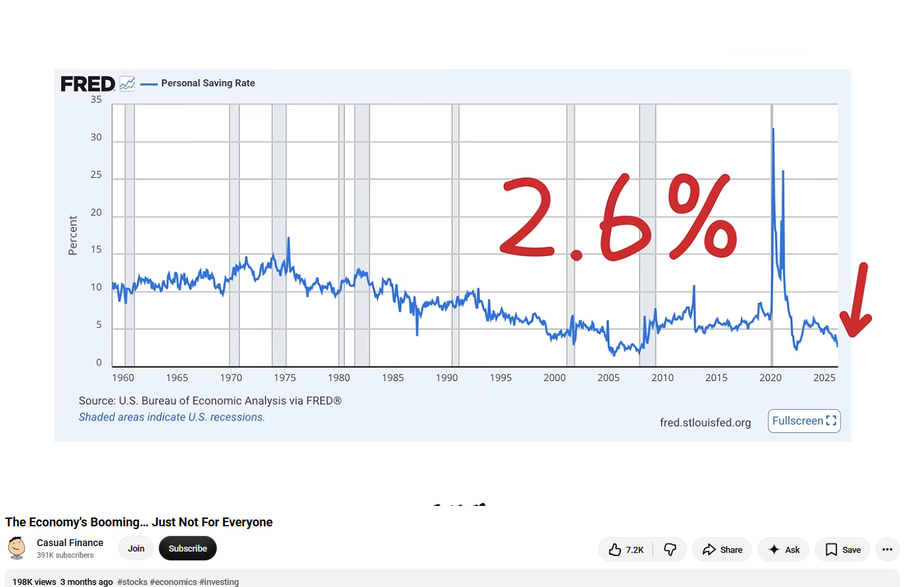
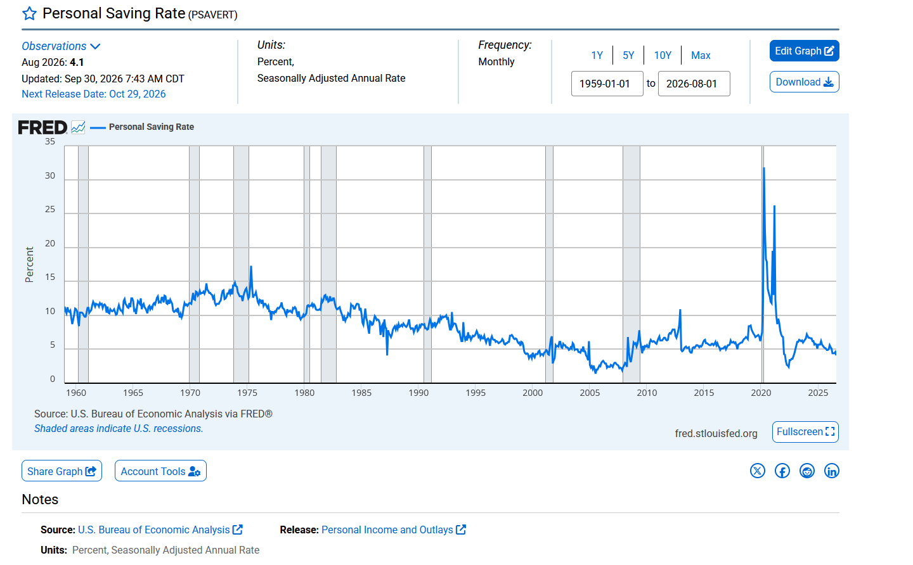
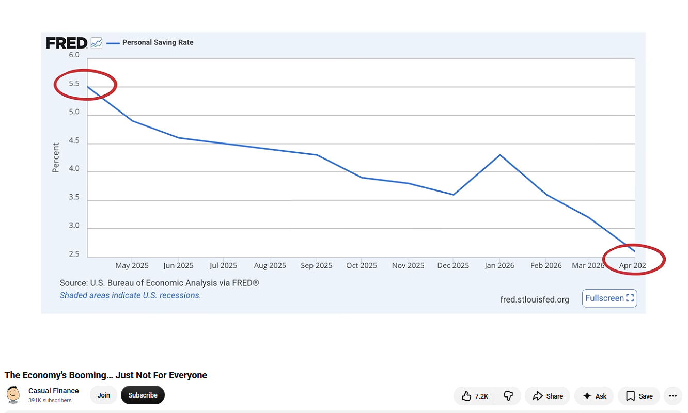
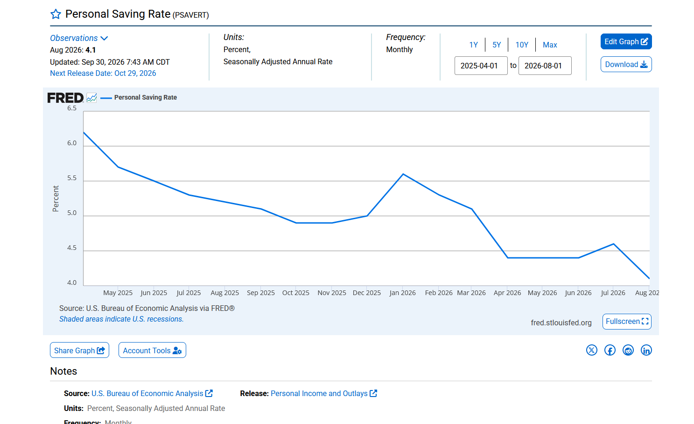

### How Creators Bend the Lines
It is becoming increasingly common for automated finance channels to manually alter data points to fit a specific narrative. 

For example here is a screenshot from a channel I occassionally watch:

Admittedly, this is three months later (10/02/2026), but here is the chart from FRED st louis on 10/02/2026:

Notice how it looks almost identical except for the very edge of the trend line on the graph.  You may also be able to discern some line thickness changes. When the channel zooms in on its version of the graph you can see the manipulation clearly. Below is the channel on youtube zooming in on the doctored chart:

Here is the real chart zoomed in to the same range (10/02/2026):

Let me start by saying that this is a channel which I occasionally watched because some of the particular narratives do match to some degree the more thoughtful longterm bearish positions of people like Dalio and others.  

Concern for the sovereign debt crises is real, the feeling of despair inside the economy because of inflation and cost of living does indeed seem high, but these charts are undeniably fake.  At first I thought it could be adjustments made to the numbers since initial relesae but the trend line drawn is completely wrong going back over a year at that point.  It doesnt even start at the right number.  It has May 2025 below 5% when May 2025 shows 5.7% on the graph at the time of writing this.

I have become somewhat interested in economic narratives in social media since reading some of the work of Schiller.  I dont know why I decided to post this but I felt fairly deceived and bothered enough to write this and its making me feel the need to go out and re-evaluate some of these other fast paced and constant financial narrative videos that are out there.  Even though I myself have a bearish feeling about the present moment the constant catastrophism required by these channels must force them to feel the need to doctor charts to create more inflammatory content.  The irony is that the charts do show interesting down trends anyway, you can still make interesting content about the real data.

Be careful who you listen to, these narratives in sufficient volume have a way of shaping thoughts.  
